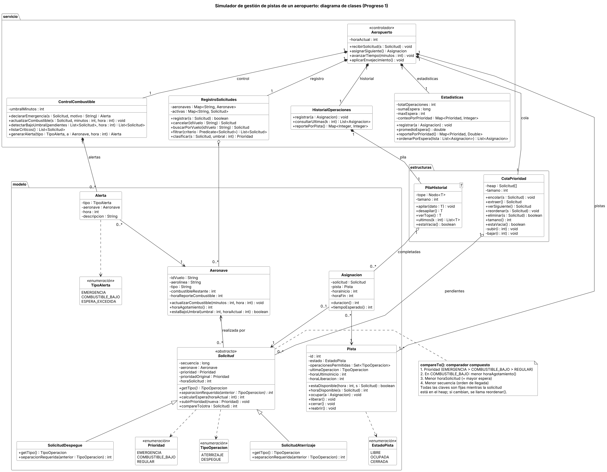

# Simulador de gestión de pistas de un aeropuerto

Proyecto de Programación III, Universidad de las Américas (UDLA), Facultad de Ingeniería y Ciencias Aplicadas.
Docente: Byron Rodríguez. NRC 2336.

Integrantes: Nicole Chancusig, David Galarza, Felipe Hurtado y Mateo Izquierdo.

## De qué trata

En un aeropuerto, varias aeronaves piden la pista al mismo tiempo para aterrizar o despegar, y entre una operación y la siguiente hay que dejar un tiempo mínimo de separación. No todas las solicitudes son igual de urgentes: una emergencia o un vuelo con poco combustible tiene que pasar antes que un vuelo regular.

Este simulador en Java recibe las solicitudes a medida que llegan, las ordena con una cola de prioridad (heap binario), asigna una pista disponible y mide cuánto espera cada vuelo.

## Reglas del modelo

Los valores son simulados, los definió el equipo y se pueden cambiar en `config/parametros.properties`.

- Una pista atiende una sola operación a la vez.
- Separación entre el inicio de dos operaciones seguidas en la misma pista: 3 minutos si es aterrizaje tras aterrizaje y 2 minutos en cualquier otro caso.
- Orden de prioridad: emergencia, combustible bajo y regular.
- Combustible bajo: aterrizajes con menos de 20 minutos de autonomía.
- A igual prioridad pasa primero la solicitud más antigua.
- Una solicitud regular que espera 15 minutos o más sube a combustible bajo, para que no espere indefinidamente. Nunca pasa por encima de una emergencia.

## Estructuras de datos

Elegimos un heap binario propio sobre un arreglo (clase `ColaPrioridad`). Para comparar dos solicitudes se usan cuatro criterios, en este orden:

1. Nivel de prioridad.
2. Si las dos tienen combustible bajo, primero la que se queda sin combustible antes.
3. La hora de solicitud más antigua.
4. El número de llegada, para que nunca haya empates.

Ninguno de estos valores cambia mientras la solicitud está en el heap. Si alguno cambia (por ejemplo, llega un nuevo reporte de combustible), la solicitud se reubica con `reordenar()`.

| Estructura | Para qué se usa | Costo |
|---|---|---|
| Heap binario (`ColaPrioridad`) | Solicitudes pendientes | Encolar y extraer O(log n) |
| Recorrido de pistas | Buscar una pista disponible | O(p), con p pistas |
| Pila enlazada (`PilaHistorial`) | Historial de operaciones | Apilar O(1) |
| HashMap (`RegistroSolicitudes`) | Buscar un vuelo por su código | O(1) en promedio |
| Merge sort | Ordenar vuelos por espera | O(m log m) |

La comparación con la otra alternativa (tres colas FIFO por nivel) está en el informe.

## Módulos y responsables

| Módulo | Clases | Responsable |
|---|---|---|
| 1. Aeronaves y solicitudes | `Aeronave`, `Solicitud`, `SolicitudAterrizaje`, `SolicitudDespegue`, `RegistroSolicitudes` | Nicole Chancusig |
| 2. Pistas | `Pista` | David Galarza |
| 3. Cola de prioridad y asignación | `ColaPrioridad`, `Asignacion`, `Aeropuerto` | Felipe Hurtado |
| 4. Emergencias y combustible | `ControlCombustible`, `Alerta` | Mateo Izquierdo |
| 5. Estadísticas e historial | `HistorialOperaciones`, `PilaHistorial`, `Estadisticas` | Nicole Chancusig y David Galarza |

El menú de consola y las pruebas de integración las hacemos entre todos.

## Diagrama de clases

Código en PlantUML: `docs/uml/diagrama-clases.puml`.



## Organización del repositorio

```
simulador-aeropuerto/
├── README.md
├── pom.xml
├── config/parametros.properties
├── docs/
│   ├── informe/        informe del Progreso 1 (PDF)
│   ├── presentacion/   diapositivas
│   └── uml/            diagrama de clases
└── src/
    ├── main/java/aeropuerto/
    │   ├── Main.java
    │   ├── modelo/         Aeronave, Solicitud, Pista, Asignacion, Alerta y enums
    │   ├── estructuras/    ColaPrioridad, PilaHistorial
    │   ├── servicio/       Aeropuerto, RegistroSolicitudes, ControlCombustible,
    │   │                   HistorialOperaciones, Estadisticas
    │   └── ui/             MenuConsola
    └── test/java/aeropuerto/   pruebas JUnit 5
```

## Cómo compilar y probar

Se necesita JDK 17 y Maven.

```
mvn compile
mvn test
java -cp target/classes aeropuerto.Main
```

## Estado

- Progreso 1: análisis, módulos, diagrama UML y selección de la estructura de datos. El código es un esqueleto con todas las clases del diagrama. Por ahora solo están programadas las reglas del diseño (el comparador, la separación entre operaciones y los cálculos de espera y combustible), y sus pruebas pasan. El resto de métodos indica qué falta y quién lo hace.
- Progreso 2: programar el heap, la asignación de pistas, el envejecimiento, el historial, las estadísticas y el menú, y activar las pruebas marcadas como pendientes.

## Uso de inteligencia artificial

Usamos IA generativa como apoyo para ordenar el informe, revisar la coherencia entre módulos y UML y generar el esqueleto de clases. Todo lo revisamos como equipo. El detalle está en el informe, en la sección de declaración de uso de IA.

Las referencias completas (APA 7) están en el informe: `docs/informe/Avance_Progreso1.pdf`.
